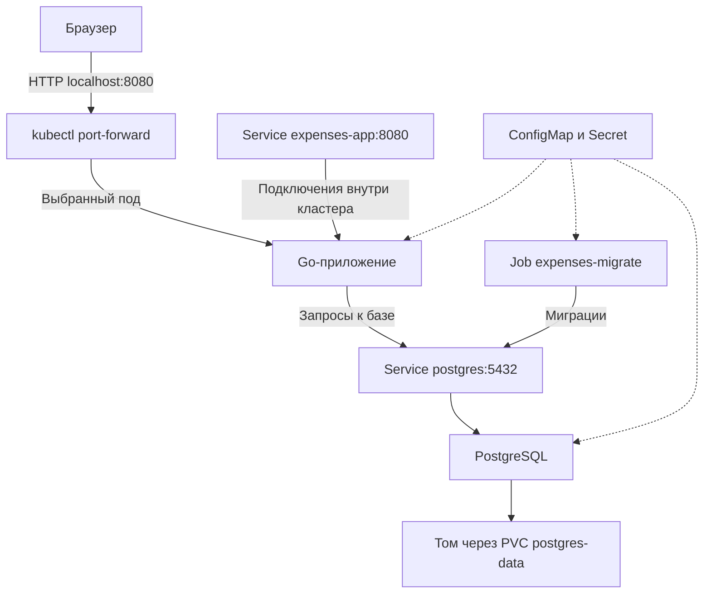

# Запуск приложения в minikube

Приложение предназначено для учёта личных расходов. В нём можно создавать категории, добавлять покупки и смотреть сумму расходов за выбранный период. Сервер написан на Go, данные хранятся в PostgreSQL. Этот же сервер отдаёт HTML, CSS и JavaScript, поэтому отдельный контейнер для интерфейса не нужен.

Для запуска используется minikube с одним узлом. Dockerfile собирает образ `accounting-for-expenses:local`. В нём находятся сервер `/app/server` и программа миграций `/app/migrate`. Манифесты Kubernetes расположены в папке `k8s`. Все ресурсы приложения создаются в стандартном пространстве имён `default`.

## Какие ресурсы используются

Для приложения создан Deployment `expenses-app`. Он запускает одну копию сервера. При масштабировании число копий увеличивается до трёх. Deployment создаёт ReplicaSet, который поддерживает нужное количество подов. Каждый под приложения содержит один контейнер.

PostgreSQL запускается через Deployment `postgres` с одной репликой. Для него выбрана стратегия `Recreate`. При обновлении Deployment старый под сначала останавливается, а затем запускается новый. Это позволяет обновлять одиночную базу без одновременного запуска старого и нового экземпляров.

Два Service дают постоянные адреса внутри кластера. Service `expenses-app` принимает подключения на порту 8080 и направляет их к готовым подам приложения. Service `postgres` работает на порту 5432 и используется для подключения к базе. Оба Service имеют тип `ClusterIP`.

PVC `postgres-data` запрашивает 1 GiB хранилища. Minikube выделяет для него постоянный том. Файлы PostgreSQL находятся на этом томе, поэтому сохраняются при пересоздании пода базы.

Job `expenses-migrate` запускает миграции из образа приложения. Они создают необходимые таблицы. После успешного выполнения программа завершается, а под получает статус `Completed`. Уже выполненные миграции при повторном запуске пропускаются.

ConfigMap `expenses-config` содержит адрес базы, имя пользователя, имя базы данных и настройки сервера. Secret `expenses-db` содержит пароль `super_secret_password`. Это пароль для учебного запуска. Настройки передаются контейнерам через переменные окружения.

## Как взаимодействуют компоненты

Браузер загружает страницу с Go-сервера. JavaScript отправляет запросы к API этого же сервера. Например, при добавлении расхода сервер проверяет данные и записывает покупку в PostgreSQL.

Приложение и миграции подключаются к базе по имени `postgres`. Кластерный DNS находит Service с этим именем, а Service направляет подключение к поду PostgreSQL. База не публикуется на компьютере пользователя.

Для открытия интерфейса используется команда `kubectl port-forward service/expenses-app 8080:8080`. Она выбирает под приложения и перенаправляет к нему запросы с локального порта 8080. Такой доступ позволяет показать интерфейс, но сам по себе не демонстрирует распределение запросов между репликами.

## Порядок запуска и проверка

Сначала создаются ConfigMap, Secret, PVC и ресурсы PostgreSQL. После готовности базы запускается Job миграций. Когда миграции завершены, создаются Deployment и Service приложения. Этот порядок выполняет команда `make k8s-up`. Отдельные команды `kubectl apply` приведены в README.md.

У PostgreSQL настроена проверка готовности через `pg_isready`. У приложения проверяется адрес `/readyz`, который проверяет подключение к базе. Если проверка приложения не проходит, его под перестаёт считаться готовым для Service.

Для демонстрации число реплик приложения увеличивается с одной до трёх командой `kubectl scale`. Все экземпляры используют общую базу, поэтому видят одни и те же категории и расходы. PostgreSQL остаётся в одной реплике. Во время её перезапуска возможны ошибки запросов. После запуска базы приложение восстанавливает соединение.

Для обычной остановки используется `minikube stop`. Удаление PVC или самого кластера может привести к потере данных. Постоянный том сохраняет данные при пересоздании пода, но не заменяет резервную копию.
