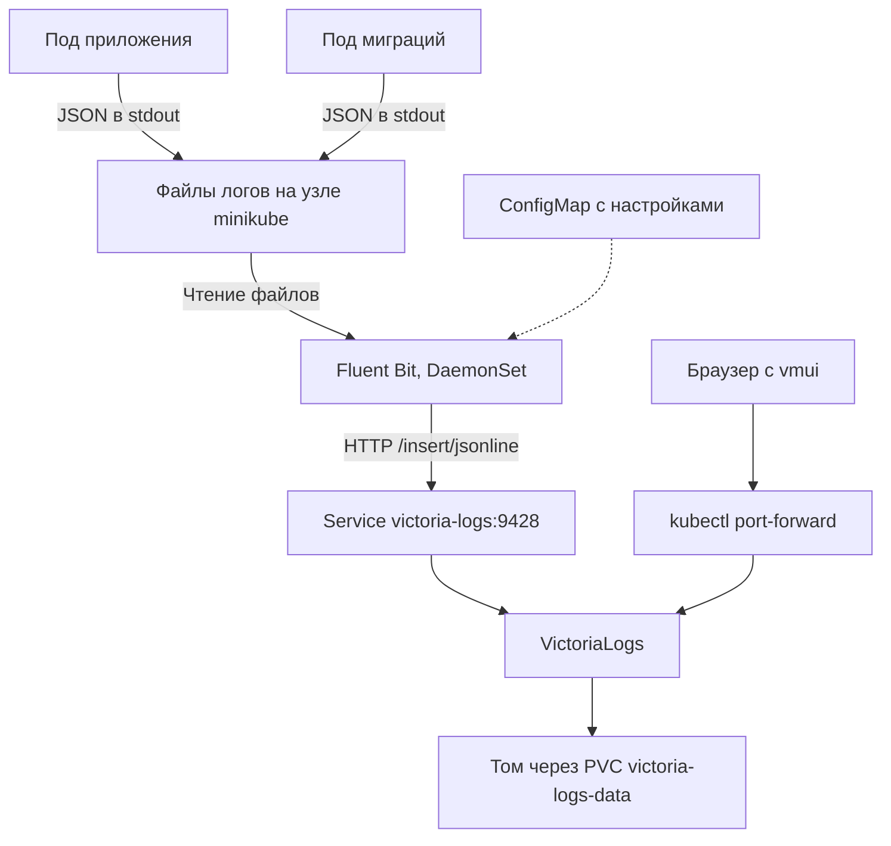
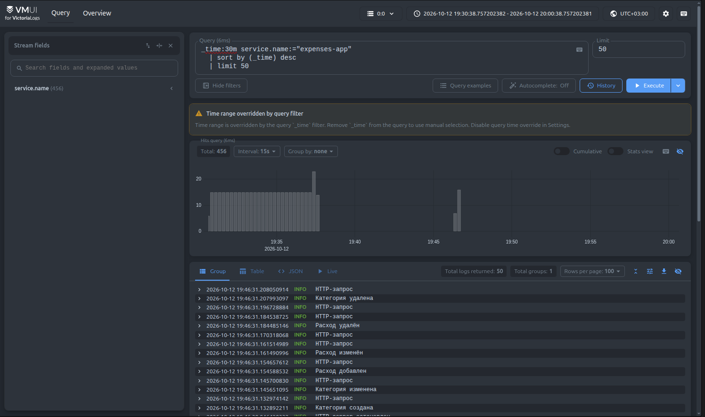
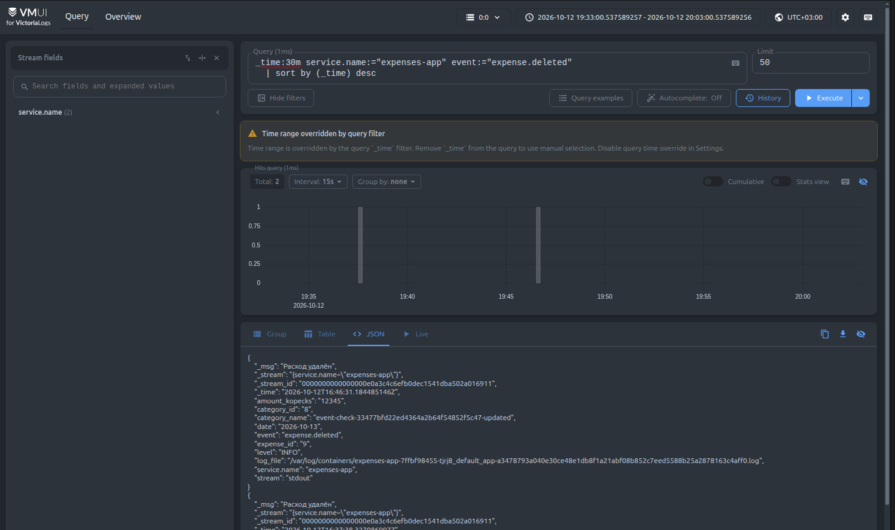
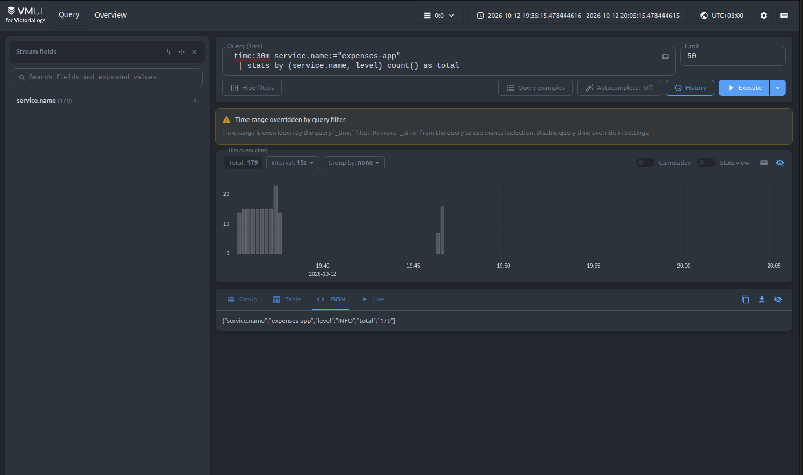
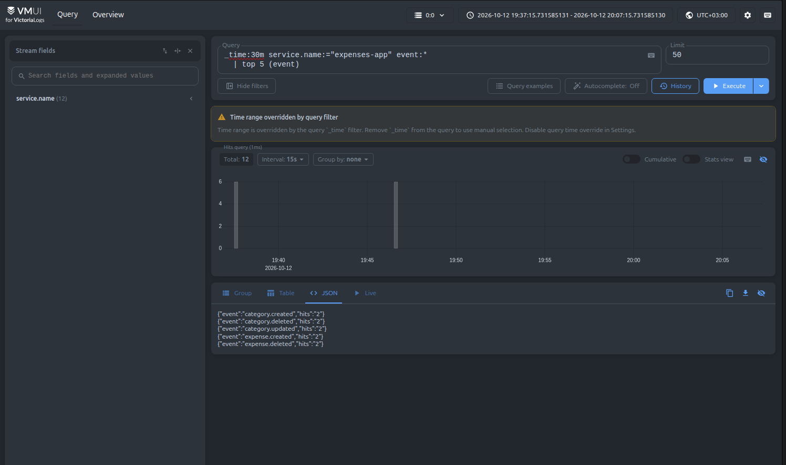
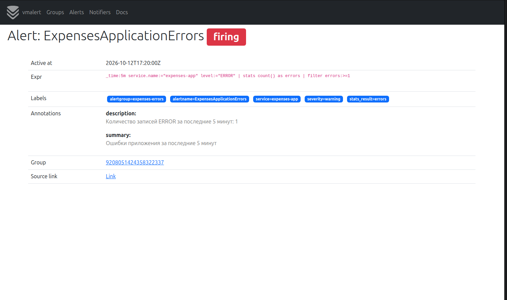
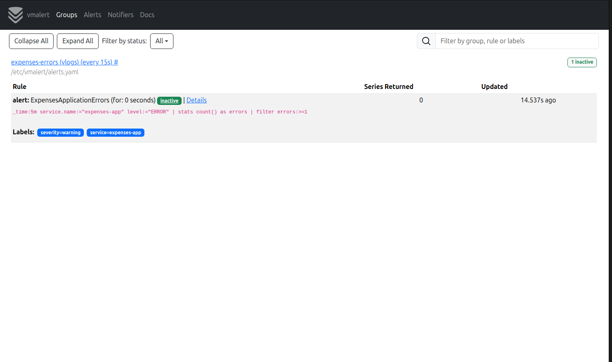

# Сбор логов приложения в VictoriaLogs

## Приложение и окружение

Приложение для учёта расходов работает в minikube. Сервер написан на Go, данные хранятся в PostgreSQL. Пользователь может создавать категории, добавлять расходы, изменять и удалять записи.

VictoriaLogs развёрнута в том же кластере и пространстве имён `default`. Используется версия `v1.53.0` в режиме single-node. Манифест [k8s/06-victoria-logs.yaml](k8s/06-victoria-logs.yaml) содержит Deployment с одной репликой, Service на порту 9428 и PVC на 2 ГБ. Срок хранения логов составляет 7 дней. Данные находятся на постоянном томе и сохраняются при пересоздании пода.

Внутри кластера VictoriaLogs доступна по адресу `http://victoria-logs:9428`. Для открытия веб-интерфейса используется команда:

```sh
kubectl --context=minikube -n default port-forward service/victoria-logs 9428:9428
```

После этого vmui доступен по адресу http://localhost:9428/select/vmui/.

## Формат логов

Сервер и программа миграций пишут JSON в stdout контейнера. Каждая строка содержит одну запись. Общие поля (из задания):

| Поле | Содержание |
| --- | --- |
| `timestamp` | Время события с часовым поясом |
| `level` | Уровень записи, например `INFO` или `ERROR` |
| `message` | Текст сообщения |
| `service.name` | `expenses-app` для сервера или `expenses-migrate` для миграций |

HTTP-записи содержат метод, путь, статус ответа, размер ответа и длительность в миллисекундах. Успешные проверки `/healthz` и `/readyz` имеют уровень `DEBUG`, поэтому при текущей настройке `INFO` они не записываются, чтобы не засорять логи.

Создание, изменение и удаление категорий и расходов записываются отдельными событиями. Поле `event` обозначает действие, например `expense.deleted`. При удалении расхода в логе остаются его идентификатор, категория, сумма в копейках и дата. При изменении расхода записываются прежние и новые значения изменённых полей. Текст комментария в журнал не попадает.

## Как доставляются логи

Для доставки используется Fluent Bit версии `5.1.3`. Его конфигурация и DaemonSet находятся в [k8s/07-fluent-bit.yaml](k8s/07-fluent-bit.yaml).

DaemonSet запускает сборщик на узле minikube. Fluent Bit читает файлы контейнеров приложения и миграций через `/var/log/containers`. Каталоги `/var/log` и `/var/lib/docker/containers` подключены с узла только для чтения. Конфигурация рассчитана на Docker runtime, который используется в этом кластере.

Первый парсер разбирает JSON-оболочку Docker. Второй извлекает поля JSON приложения из поля `log`. Сборщик выбирает stdout и записи с полем `timestamp`, затем отправляет их в VictoriaLogs через HTTP `/insert/jsonline`.

В VictoriaLogs поле `timestamp` становится `_time`, а `message` становится `_msg`. Поле `service.name` определяет поток логов. Остальные поля приложения доступны для поиска и агрегации. Поле `log_file` содержит путь к файлу и позволяет определить исходный под.



Такой способ позволяет собирать логи всех реплик одним сборщиком на узле. Приложение просто пишет в stdout и не зависит от адреса VictoriaLogs. Отдельный контейнер для сбора логов в каждом поде приложения не нужен.

Позиции чтения и очередь отправки хранятся на узле. После перезапуска Fluent Bit продолжает чтение с сохранённого места. Размер очереди ограничен 128 MiB, неудачные отправки повторяются. При длительной недоступности хранилища и переполнении очереди возможна потеря записей. Повторная отправка может приводить к дублям.

## Запросы в vmui

Все четыре запроса выполнены через веб-интерфейс vmui. Скриншоты сделаны 12 октября 2026 года, время интерфейса соответствует Москве. Каждый запрос выбирает последние 30 минут на момент выполнения. При повторном запуске результаты могут отличаться.

Уведомление `Time range overridden by query filter` означает, что интервал задан полем `_time` в запросе. Это не ошибка выполнения.

### 1. Сырые записи за последние 30 минут

```text
_time:30m service.name:="expenses-app"
| sort by (_time) desc
| limit 50
```

Запрос выбирает записи сервера за последние 30 минут, сортирует их от новых к старым и выводит не более 50 записей. Поля не агрегируются. В результате видны HTTP-запросы, события работы с расходами и сообщения сервера.



### 2. Фильтр по событию удаления расхода

```text
_time:30m service.name:="expenses-app" event:="expense.deleted"
| sort by (_time) desc
```

Запрос выбирает точное значение поля `event`. В результат попадают только события удаления расходов, без HTTP-записей и других действий. Он позволяет найти удалённую запись по журналу и посмотреть её данные.



### 3. Количество записей по сервису и уровню

```text
_time:30m service.name:="expenses-app"
| stats by (service.name, level) count() as total
```

`stats` объединяет записи по сервису и уровню. Функция `count()` считает записи в каждой группе, а `as total` задаёт название итогового поля.

На скриншоте получена одна группа: сервис - `expenses-app`, уровень - `INFO`, количество - `179`. Это число записей журнала, а не расходов или пользователей. `ERROR` появится, если в выбранном интервале есть записи этого уровня.



### 4. Пять самых частых событий приложения

```text
_time:30m service.name:="expenses-app" event:*
| top 5 (event)
```

Фильтр `event:*` оставляет записи с непустым полем события. Оператор `top` выбирает пять самых частых значений этого поля. Частота каждого значения находится в поле `hits`.



## Проверка

При проверке через API выполнялись создание, изменение и удаление тестовых категорий и расходов. Все шесть типов событий дошли до VictoriaLogs. Для новых событий проверены названия категорий, суммы, даты и прежние и новые значения изменённых полей. Неудачные операции не создают событий успеха. Тестовые записи удалены из приложения, но их события остаются в журнале.

Также проверена доставка логов после перезапуска сборщика и пересоздания подов приложения. Логи завершившегося Job миграций доступны в VictoriaLogs с именем сервиса `expenses-migrate`.


## Бонус. Алерт на ошибки приложения

В том же minikube развёрнут vmalert версии `v1.154.0`. Манифест [k8s/08-vmalert.yaml](k8s/08-vmalert.yaml) содержит Deployment, Service и ConfigMap с правилом `ExpensesApplicationErrors`.

Правило использует подсчёт записей из третьего запроса с фильтром по уровню `ERROR`. Оно проверяется каждые 15 секунд и выбирает ошибки сервиса `expenses-app` за последние 5 минут:

```text
_time:5m service.name:="expenses-app" level:="ERROR"
| stats count() as errors
| filter errors:>=1
```

Если есть хотя бы одна запись, алерт переходит в `Firing`. Если за последние пять минут ошибок нет, запрос не возвращает строк и состояние становится `Inactive`. Поле `health` показывает, успешно ли вычисляется правило. Значение `ok` возможно и при сработавшем алерте. Если логи не доходят до VictoriaLogs, правило не сможет обнаружить ошибки приложения.

Источник данных vmalert настроен на `http://victoria-logs:9428`, тип группы правил равен `vlogs`. Используется режим `-notifier.blackhole`, поэтому срабатывание видно в интерфейсе, но внешние уведомления не отправляются. История состояний не сохраняется в отдельном хранилище.

Для открытия интерфейса используется команда:

```sh
kubectl --context=minikube -n default port-forward service/vmalert 8880:8880
```

Список правил доступен по адресу http://localhost:8880/vmalert/groups.

Для проверки чтение таблицы категорий блокируется отдельной транзакцией на 15 секунд. Запрос списка категорий достигает таймаута 10 секунд и возвращает HTTP 504. Сервер записывает `ERROR`, Fluent Bit доставляет запись в VictoriaLogs, а vmalert переводит правило в `Firing` со значением `1`. После завершения транзакции блокировка снимается, данные не изменяются, запрос списка категорий снова выполняется успешно.


На первом скриншоте алерт находится в состоянии `firing`. В описании указана одна запись `ERROR` за последние пять минут.



После пяти минут без новых ошибок алерт автоматически перешёл в `inactive`. На втором скриншоте `Series Returned` равно `0`, поскольку условие запроса больше не выполняется. Срабатывание и снятие алерта проверены через API vmalert и его веб-интерфейс.


